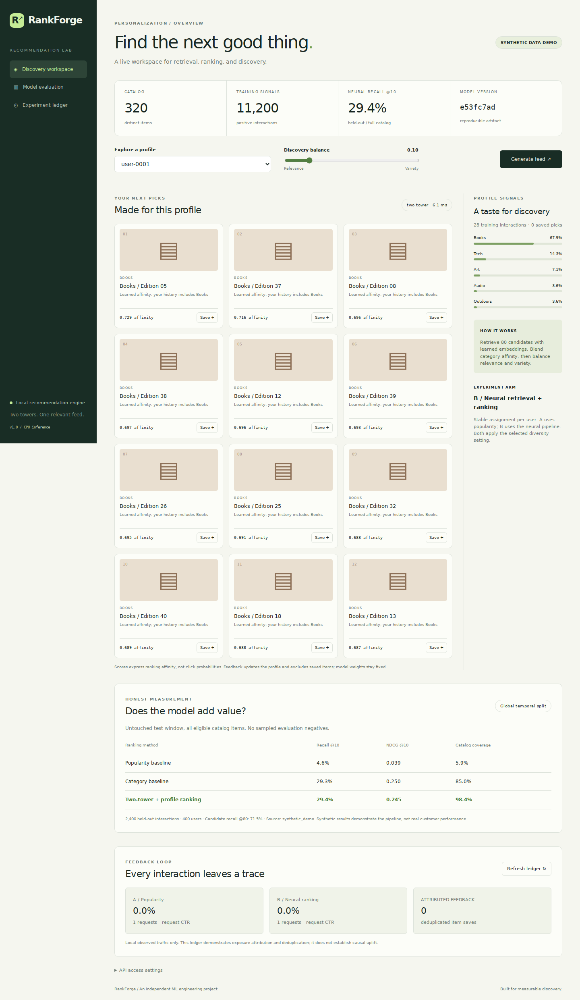

# RankForge

**A two-stage recommendation service with neural retrieval, profile ranking, and an auditable feedback loop.**

RankForge turns implicit interactions into a personalized catalog feed. It trains a small two-tower network, retrieves candidates with learned embeddings, adds category affinity, and optionally diversifies the final list. A browser dashboard lets you switch profiles, save recommendations, and inspect model quality and experiment traffic.

This is an independent portfolio implementation, with working training, API, persistence, tests, and container configuration. The included model was trained on explicitly synthetic data. It has not served production users.



## Run it

Python 3.11 or 3.12 is recommended. No GPU, external model API, account, or API key is required.

```bash
python -m venv .venv
# Linux / macOS
source .venv/bin/activate
# Windows PowerShell: .venv\Scripts\Activate.ps1

# Optional: lighter CPU installation on Linux / Windows
python -m pip install torch==2.8.0 --index-url https://download.pytorch.org/whl/cpu
python -m pip install -e '.[dev]'
python -m rankforge.cli serve
```

Open **http://127.0.0.1:8000**. The checked-in model is ready to use. API documentation is at `/docs`; liveness is `/health`, readiness is `/ready`, and process counters are `/metrics`.

To rebuild the model and its evaluation:

```bash
python -m rankforge.cli demo --seed 42 --epochs 30
```

On Windows you can also run `start_windows.bat`; on Linux/macOS run `bash start_unix.sh`.

## What is implemented

| Capability | Implementation |
|---|---|
| Neural retrieval | Two-tower network: user ID + training category profile, item ID + category embedding; MLP towers, normalized embeddings, pairwise logistic loss |
| Candidate generation | Exact dot-product retrieval of up to 80 unseen, available items |
| Ranking | Validation-selected blend of neural similarity and category affinity |
| Diversity | Greedy maximal marginal relevance (MMR) in learned embedding space |
| Cold start | Popularity fallback when both user identity and history are unknown |
| Serving | Typed, validated HTTP API and responsive same-origin dashboard |
| Feedback | Durable exposure attribution, payload-aware event idempotency, one save per exposure-item pair |
| Experiments | Stable user assignment: A = popularity, B = neural; both use the requested diversity setting |
| Evaluation | Global temporal split, full-catalog ranking, user-macro Recall/NDCG, baseline comparison and coverage |
| Engineering | Parameterized SQL, bearer-token option, readiness checks, container, CI and regression tests |

The retrieval index is an exact matrix scan at this catalog size. There is no ANN service, distributed training, message broker, or large-scale performance claim.

## Measured example

Seed 42; 400 users; 320 items; 11,200 training, 2,400 validation, and 2,400 test interactions. Full-catalog test results from [`artifacts/report.json`](artifacts/report.json):

| Method | Recall@10 | NDCG@10 | Catalog coverage@10 |
|---|---:|---:|---:|
| Popularity | 0.0458 | 0.0388 | 0.0594 |
| Category baseline | 0.2929 | **0.2497** | 0.8500 |
| Two-tower + profile ranking | **0.2938** | 0.2451 | **0.9844** |

The neural pipeline beats popularity on this fixture, but does **not** beat the simpler category baseline on NDCG. The synthetic generator contains strong category preferences, so the simple baseline is competitive. The small recall difference is not evidence of statistical superiority. Results demonstrate implementation correctness and reproducibility, not real-world recommendation quality.

The report also contains candidate Recall@80, training loss, checkpoint selection, configuration, environment, data SHA-256, and measured in-process inference timing. Timing excludes HTTP, SQLite, and network costs. Offline evaluation uses `diversity=0`; the interactive dashboard defaults to `0.1`, so its rankings can differ.

## Data and leakage controls

Training, validation, and test windows use **global timestamp boundaries**. Training profiles, popularity counts, and negative pools use training interactions only. The best checkpoint and blend coefficient are chosen on validation NDCG; test labels are not used for model selection. A regression test changes test labels and checks that the selected artifact stays identical.

Training negatives are unobserved training items, not verified dislikes. Some may become future positives. Full-catalog evaluation avoids artificially easy sampled-negative metrics. Test ranking excludes training and validation items already observed by that user. The model is frozen at the training cutoff; validation history is used only for test exclusion, not for updating embeddings or profiles. New users are included through the fallback and counted in the report.

The demo uses synthetic positive feedback sampled without replacement from latent category and style preferences. Hidden preferences never enter the model's input. No external customer data is included.

## Use your own data

Supply UTF-8 CSV files in one folder:

```csv
# catalog.csv (omit this comment)
item_id,title,category,available_at
item-1,Example catalog entry,Outdoors,1700000000
```

```csv
# interactions.csv (omit this comment)
user_id,item_id,timestamp
user-1,item-1,1700000100
```

Timestamps are integer UTC epoch seconds. IDs are strings. Aggregate repeated positive user-item events before importing. Catalog IDs must be unique; every event must reference an item available at that timestamp; all three time windows must be nonempty. Every training user needs at least one unobserved eligible item for negative sampling.

```bash
python -m rankforge.cli train --data ./data --train-end 1710000000 --validation-end 1715000000 --output artifacts
```

Choose boundaries that fit your dataset. Restart the server after replacing artifacts. For schema examples generated from the demo, use `python -m rankforge.cli demo --export-csv runtime/demo-data`.

## API example

```bash
curl 'http://127.0.0.1:8000/api/recommendations?user_id=user-0001&k=5&diversity=0.1'
```

The response includes `request_id`, assigned experiment arm, method, model version, measured request latency, and ranked items. Submit a save using the returned user, request and item identifiers:

```bash
curl -X POST http://127.0.0.1:8000/api/feedback \
  -H 'Content-Type: application/json' \
  -d '{"event_id":"unique-event-1","request_id":"RETURNED_REQUEST_ID","user_id":"user-0001","item_id":"RETURNED_ITEM_ID"}'
```

An identical retry returns `inserted: false`; reusing an event ID with different content returns 409. An item outside the exposure, or feedback attributed to another user, returns 422. Saves update the request-time category profile and seen-item filter; **they do not retrain weights**.

## Tests and containers

```bash
python -m pytest -q
python -m ruff check .
python -m ruff format --check .
docker compose up --build
```

CI runs lint, tests and a model-training smoke test on Python 3.11/3.12. The container runs as an unprivileged user, with a persistent SQLite volume and a readiness health check. Container configuration is included; container execution depends on a working local Docker installation.

## Configuration and deployment boundary

| Environment variable | Default | Purpose |
|---|---|---|
| `RANKFORGE_ARTIFACTS` | `artifacts` | Model + report directory |
| `RANKFORGE_DB` | `runtime/events.db` | Feedback database |
| `RANKFORGE_API_TOKEN` | empty | Require a bearer token for all data endpoints and metrics |
| `RANKFORGE_TORCH_THREADS` | `1` | CPU thread budget |

Default serving binds to localhost. If a token is configured, enter it under API access settings in the dashboard; it stays in page memory and is not written to browser storage. `/health`, `/ready`, dashboard assets, and API schema remain public. A shared token controls API access; it is **not user authentication** and does not prevent one authorized client from impersonating a user ID.

For external deployment, add TLS, identity-based authorization, rate limits, retention/deletion policies, backup/restore procedures, and external monitoring. SQLite suits this single-instance demo; concurrent multi-instance serving needs a shared transactional store. Process counters reset on restart and are per worker. The ledger records successful recommendation responses as exposures, not verified human impressions. Request CTR is descriptive observed traffic; no causal A/B result is claimed.

## Design notes

- [Architecture and tradeoffs](docs/ARCHITECTURE.md)
- [Model and data card](docs/MODEL_CARD.md)
- [Interview walkthrough](docs/INTERVIEW_GUIDE.md)
- [Russian quick start](README_RU.md)

Author: Jaber Mobarak. MIT license for code and generated demo artifacts.
