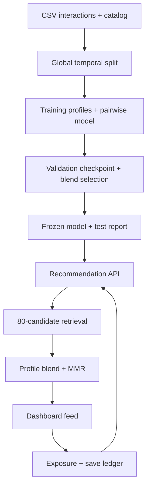

# Architecture and tradeoffs

The training artifact stores mapping tables, training histories, popularity counts and tensor weights as JSON. Loading does not execute pickle payloads. The version is a content hash of the selected model configuration and weights. The report additionally fingerprints the complete input dataset, including evaluation data.

User tower input concatenates a learned user embedding with the normalized category distribution of observed positives. Item input adds an item embedding to its category embedding. Separate MLP towers project these inputs into a common 24-dimensional normalized space. Training minimizes `softplus(-8 * (s_positive - s_negative))` using sampled unobserved training items. No target click probability is estimated.

Serving computes exact dot products against all item embeddings, excludes seen/unavailable items, and retrieves at most 80 candidates. A validation-selected coefficient blends similarity with category affinity. Optional MMR penalizes maximum cosine similarity to already-selected candidates. The candidate stage bounds reranking cost but also limits recall; the report measures that ceiling.

Unknown user IDs use the zero user embedding; an empty profile triggers popularity fallback. A new user's first saved item creates a usable category profile without changing weights. The dashboard's reason text describes observed history and method, not a causal explanation of a network's decision.

Each recommendation response gets a new exposure ID. Feedback must match that exposure's user and catalog items. SQLite transactions and unique constraints make retries idempotent. `BEGIN IMMEDIATE` serializes feedback checks across concurrent requests; WAL and a busy timeout reduce lock contention. Each operation owns its connection. Database writes use parameters, including untrusted user IDs.

Experiment assignment hashes a fixed namespace plus user ID. Clients cannot choose the arm through the recommendation API. Arm A uses popularity; arm B uses neural retrieval and profile ranking. Both arms use the requested MMR diversity setting. This is experiment infrastructure, not a controlled online trial: users can change diversity, exposure logging occurs before browser rendering, clients can invent user IDs, and the application has no identity service.

Intentional limits: exact retrieval instead of ANN, one process-oriented service instead of distributed inference, local SQLite instead of a shared data platform, and synthetic observations instead of customer traffic. These keep the project runnable and the measurements inspectable. Add scale components only after profiling a larger real dataset and defining latency/availability targets.
